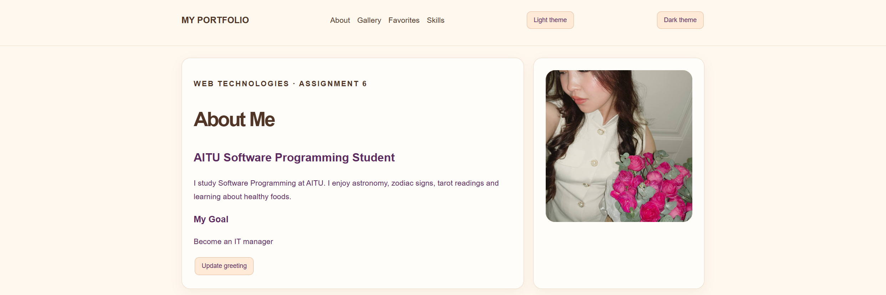
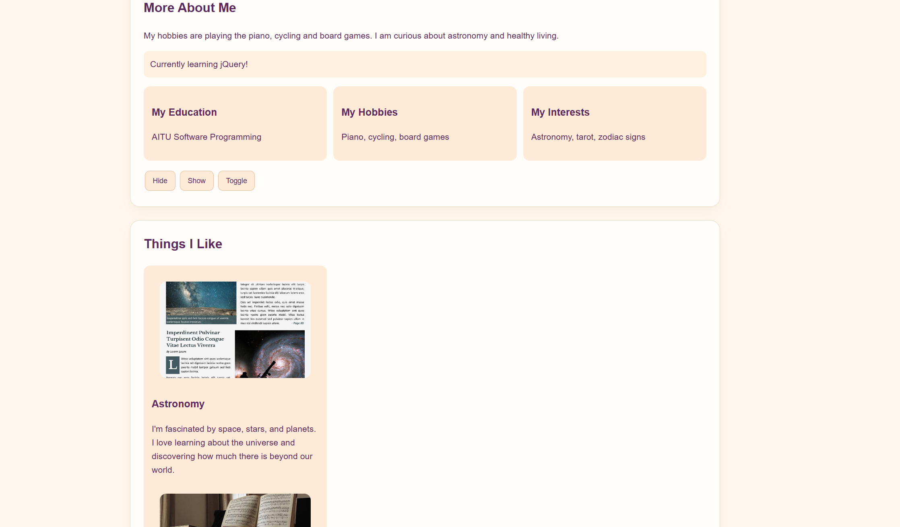
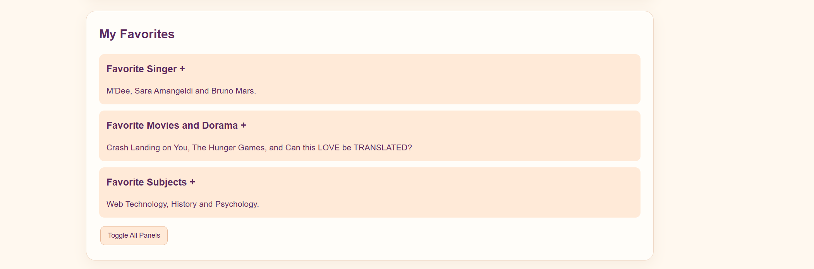
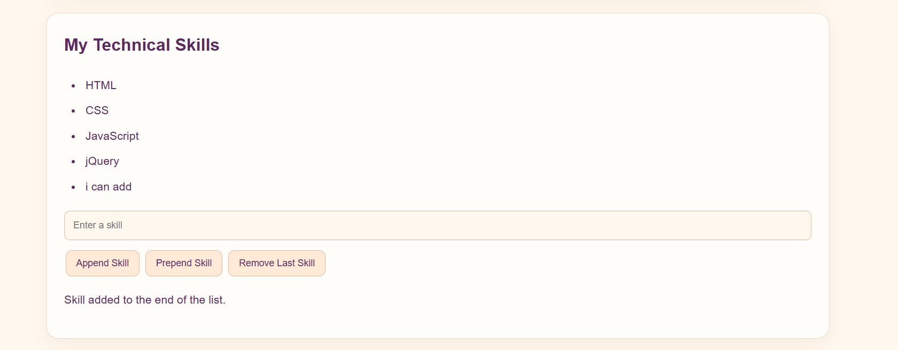
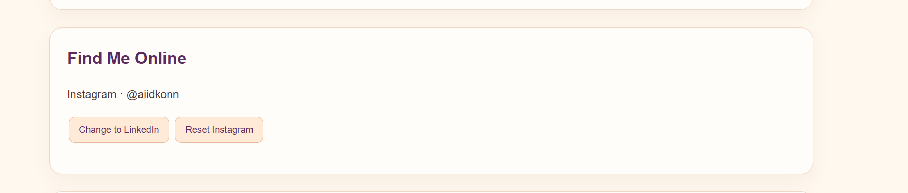
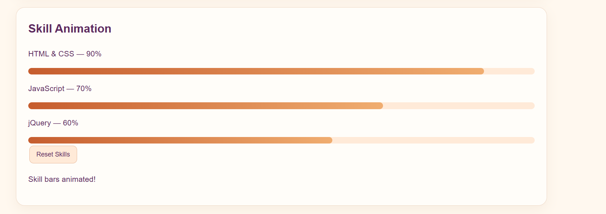

# Assignment 6 – My Personal Portfolio
NAME:AIDANA MURATOVA SE-2539
LINK: muratovaajdana201-ctrl/assignment6webaidana
WEB LINK: https://muratovaajdana201-ctrl.github.io/assignment6webaidana/

## About the Project

For this assignment, I created a personal portfolio website using HTML, CSS and jQuery. The website is about me, my hobbies, interests and skills.

I wanted to make a simple and nice-looking website where I could also practise the jQuery methods from our assignment. I added interactive buttons, visual effects, a live form preview and skill animations.

## Technologies Used

-HTML5
-CSS3
-JavaScript
-jQuery 3.7.1

## Features

In my project, I used different jQuery methods and added the following features:

-Selectors and CSS: changed text and styles using jQuery selectors and .css().
-Hide, Show and Toggle: added buttons to hide and show personal information.
-Fade Effects: used .fadeIn(), .fadeOut() and .fadeToggle() for the gallery.
-Slide Effects: created an accordion with expandable sections using slide animations.
-DOM Manipulation: added new skills to the list and removed existing ones.
-Attributes: used .attr() to change my social media link.
-Live Form Preview: the name and email appear automatically while typing.
-Animation: added animated skill bars using .animate().
-Themes: added light and dark theme buttons.

## Screenshots

Here are some screenshots of my website and its main features.

### 1. Homepage

The main page with navigation, my introduction, profile section and theme buttons.

### 2. About Me and Gallery

This section contains some information about me, my hobbies and the gallery.

### 3. Favorites

My favorite music, movies and subjects. The accordion sections can be opened and closed.

### 4. Skills

My skills list with buttons to add a skill, add it at the beginning or remove the last item.

### 5. Contact Form

A simple form with a live preview. The information changes while typing.

### 6. Animation and Theme

The animated skill bars and the dark theme of the website.

## What I Learned

While working on this project, I got more practice with jQuery and learned how to make website elements interactive. I also understood better how to work with selectors, events, effects and animations.

I liked that I could use these methods in my own portfolio and make the website more personal.

## Conclusion

This assignment helped me practise the main jQuery methods and apply them in a real website. I am happy with the result because I was able to create a portfolio that includes both my personal information and the required interactive features.
